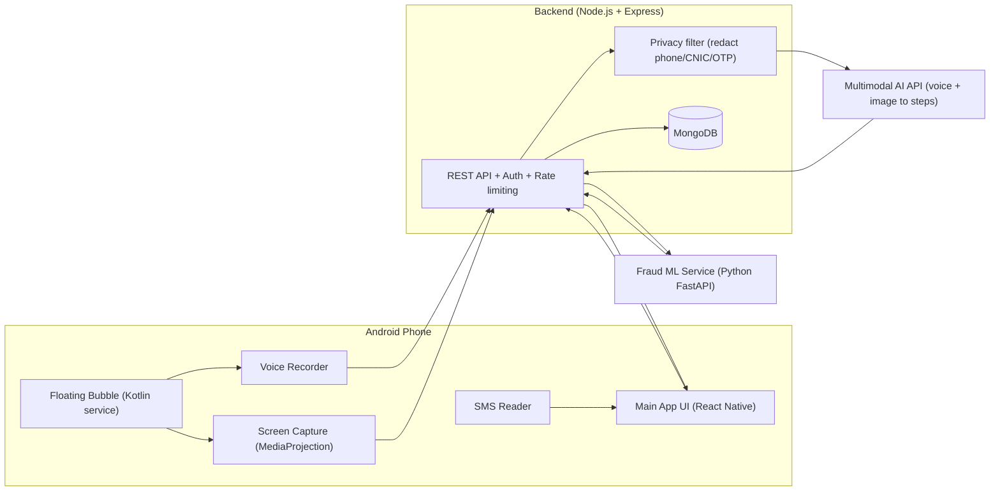

# Madadgar (مددگار) — A Digital Helper That Lives On Your Screen

> **Build4Better Hackathon 2026 — NED University, Department of Software Engineering**
> *(Replace "Madadgar" with your final app name.)*

## 1. Target User and Problem

**Target user:** Parents, grandparents and anyone who did not grow up with technology (age 50+, low digital confidence, Urdu as first language).

**Problem:** When these users get stuck in an app (a banking app that logged them out, a video call that won't connect, a confusing government form) they call their children. Many give up or avoid useful apps because they fear breaking something or looking foolish. They are also the easiest targets for scam SMS messages (fake JazzCash/Easypaisa refunds, fake prize and aid messages, fake "account blocked" alerts).

The issue is not intelligence. Technology is built for people who already speak its language.

## 2. Our Solution

Madadgar is an Android app that puts a **small floating help bubble on top of every app**. When the user gets stuck in *any* app, they:

1. Tap the bubble.
2. **Say the problem in their own words** (Urdu / Roman Urdu / English).
3. Allow a one-time **screen capture**.
4. Receive **simple, numbered, large-text steps (with voice read-aloud)** that refer to what is actually on their screen.
5. Do the steps themselves. If they get stuck at any step, they tap the bubble again and get help for *that* step.

The user is **guided to do the task themselves**, not given a shortcut that does it for them. This builds confidence instead of dependency.

A second feature, **Fraud Check**, lets the user allow access to their SMS inbox. Our system classifies each message as **Fraud**, **Safe** or **Not Sure** and tells the user what to do in plain language.

## 3. Core Features

### 3.1 Floating Help Bubble
- A draggable bubble that stays on top of all apps (Android "draw over other apps" permission).
- Runs as a foreground service so it stays alive while the user is in another app.
- Tap opens a mini panel: **"Madad chahiye" (Need help)** and **"Yeh message check karo" (Check a message)**.

### 3.2 Voice + Screen Help
- Voice note recording with a big mic button and a visible timer (like YouTube/Google voice search).
- A clear pop-up explains *why* screen capture is needed, then Android's own screen-capture permission dialog appears. The user must allow it every time.
- Voice and screenshot are sent to our backend, which asks a multimodal AI model for step-by-step guidance.
- The reply is shown **one step at a time** in large text, with "Next step", "Repeat", and "I'm stuck here" buttons, plus read-aloud (Text-to-Speech).
- **Follow-up help:** tapping the bubble again at any step sends a new screenshot and voice note together with the earlier steps as context, so the AI knows where the user is.

### 3.3 Fraud Message Detection
- The user grants SMS permission (with a clear explanation screen).
- Each message gets one of three verdicts:

| Verdict | What the app shows | User options |
|---|---|---|
| **Fraud** (high confidence) | Red card, "This looks like a scam" with the reason in simple words | **Delete** / **Keep** |
| **Safe** (low risk) | Green card, "This looks fine" | **Keep** |
| **Not Sure** (middle confidence) | Yellow card, "We are not sure, do not click links or share codes" | **Delete** / **Keep** |

- Verdicts come from our **own trained ML model** combined with simple rule checks (suspicious links, urgency words, requests for OTP/PIN, unknown sender patterns).
- The user's choice (delete/keep) is saved and used as feedback to improve the model.

### 3.4 History (Database)
- Past help sessions, fraud verdicts and the user's decisions are saved, so the user can look back at "how did I do that again?".

### 3.5 Accessibility-First UI/UX
- Minimum 20 sp body text, 28 sp+ headings, high-contrast colors (WCAG AA or better).
- Large tap targets (at least 56 dp), one action per screen, no hidden gestures.
- Urdu (RTL) primary, with English switch; simple everyday words, no jargon.
- Voice read-aloud for every instruction.
- Calm color coding: green = safe, yellow = careful, red = danger.
- Never blames the user: the language is always encouraging ("Koi baat nahi, dobara try karte hain").

### 3.6 Family Dashboard *(stretch goal, only if time permits)*
- A small React web dashboard where a linked family member (with the parent's consent) can see which tasks the parent struggled with and which scams were caught. No message text is shown, only categories and counts.

## 4. System Architecture



### Flow A: Help Request
1. User taps the bubble, then records a voice note.
2. A consent pop-up appears, then Android's screen-capture dialog. The app takes **one screenshot** only.
3. App uploads `{audio, screenshot, language, sessionId, previousSteps}` over HTTPS to the backend.
4. Backend authenticates the request, runs the **privacy filter**, and sends audio + image to the multimodal AI with a carefully written system prompt (see section 6).
5. AI returns structured JSON: a short summary, numbered steps, an optional warning. Backend validates it and saves only the text result.
6. App shows one step at a time with read-aloud. The screenshot and audio are **deleted from the server immediately after processing** (never stored).

### Flow B: Fraud Check
1. User grants SMS permission and taps "Check my messages" (or a new message arrives and the user is notified).
2. App sends **only the message text to be checked** (not the whole inbox) to the backend over HTTPS.
3. Backend calls the Fraud ML service, which returns `{label, confidence, reasons}`.
4. Backend maps confidence to the three verdicts (thresholds are configurable).
5. App shows the verdict card. The user picks Delete or Keep. The decision is stored as feedback.

## 5. Technology Stack

| Layer | Technology | Why |
|---|---|---|
| **Mobile app** | React Native (bare workflow, TypeScript) | Team already knows React/JS |
| **Native Android modules** | Kotlin | Floating bubble overlay, MediaProjection screen capture, and SMS access need native Android APIs |
| **Backend** | Node.js + Express | MERN stack, fast to build |
| **Database** | MongoDB (Atlas or local) + Mongoose | Flexible schema for sessions and verdicts |
| **Auth** | JWT (short-lived) + phone-number login; tokens stored in Android Keystore | Simple for elderly users, secure storage |
| **AI help engine** | Multimodal LLM API that accepts audio and image (e.g., Google Gemini API; swappable with Claude or OpenAI) | One call understands the screenshot and the spoken problem |
| **Speech output** | Android built-in Text-to-Speech (Urdu/English) | Free, works offline |
| **Fraud ML service** | Python 3, scikit-learn, FastAPI | Quick to train and serve |
| **Family dashboard (stretch)** | React + Vite | Same MERN skills |
| **Security libs** | helmet, express-rate-limit, bcrypt, zod (validation), AES-256-GCM (Node `crypto`) | See section 7 |

> **Platform note:** The floating bubble, screen capture and SMS access are Android features. iOS does not allow these, so the app targets **Android 10+**.

## 6. How the AI Help Engine Works

- The backend builds one request containing: the user's **voice note** (or its transcript), the **screenshot**, the **language**, and **previous steps** (for follow-ups).
- The system prompt instructs the model to:
  1. Act as a patient teacher for an elderly user, in simple Urdu (or the user's language).
  2. Describe only what is **visible on the screenshot**, and mention buttons by their colour/position/label.
  3. Give **at most 5 short steps**, one action each.
  4. **Never ask for or repeat** passwords, PINs, OTPs or card numbers, and warn the user never to share them.
  5. If the screen looks like a scam or phishing page, say so first.
  6. If unsure, say so and ask the user to repeat or show another screen instead of guessing.
- The model must reply in strict JSON, validated with `zod` before reaching the app:

```json
{
  "summary": "Aap video call join karna chahte hain.",
  "steps": [
    { "n": 1, "text": "Neeche hare rang ke 'Join' button par dabaiye.", "hint": "Button screen ke neeche darmiyan mein hai." }
  ],
  "warning": null,
  "needsMoreInfo": false
}
```

## 7. Fraud Detection Model (Training Plan)

**Task:** 3-way output (Fraud / Safe / Not Sure) built from a binary classifier plus confidence thresholds.

**Data:**
- Public SMS spam datasets (e.g., UCI SMS Spam Collection) for the base model.
- A **self-collected and hand-labelled set of Pakistan-specific messages** (Urdu, Roman Urdu, English): fake JazzCash/Easypaisa refunds, BISP/aid prize messages, "account blocked" alerts, fake delivery links, plus genuine bank/telecom/OTP messages. Teammates can contribute messages from their own families (with personal details removed).

**Pipeline:**
1. Clean text, normalise Roman Urdu spellings, mask numbers and links as tokens (`<URL>`, `<NUM>`).
2. Features: TF-IDF (word + character n-grams) and extra hand-crafted features (has link, urgency words, asks for OTP/PIN/CNIC, sender type).
3. Models compared: Logistic Regression, Linear SVM, Naive Bayes. Best is chosen by **F1 and recall on the Fraud class** (missing a scam is worse than a false alarm).
4. **Calibrate probabilities**, then map: `p ≥ 0.80` → Fraud, `p ≤ 0.30` → Safe, otherwise → Not Sure (thresholds tuned on validation data).
5. Report accuracy, precision, recall, F1 and a confusion matrix in `ml/REPORT.md`.
6. **Improvement loop:** user decisions (Delete/Keep) are stored as feedback; the model can be retrained from this data.

## 8. Privacy and Security (Protecting the User's Messages)

Access to SMS is sensitive, so we apply these rules:

1. **Consent first:** a plain-language screen explains what is accessed and why. Permissions are requested only when the feature is used and can be revoked any time.
2. **Minimum data:** only the message selected for checking is sent. The full inbox is never uploaded.
3. **Redaction before AI/ML:** phone numbers, CNIC numbers, card numbers and OTP-like digit strings are masked on the backend before any message text is processed or sent to a third-party API.
4. **Encrypted transport:** HTTPS/TLS only.
5. **Encrypted storage:** if message text is saved at all, it is encrypted per field with AES-256-GCM. By default we store only the **label, confidence, timestamp and user decision**, not the raw text.
6. **No storage of screenshots or audio:** deleted right after processing.
7. **Secrets stay on the server:** AI API keys are never inside the mobile app. The app talks only to our backend.
8. **Backend hardening:** JWT auth, per-user rate limits, input validation, `helmet`, no sensitive data in logs.
9. **User control:** the user can delete their history and account.
10. **Third-party processing disclosure:** screenshots/voice are processed by an external AI API. This is stated in the consent screen and in this README.

## 9. Database Design (MongoDB)

| Collection | Main fields |
|---|---|
| `users` | `_id`, `name`, `phone` (hashed), `language`, `createdAt` |
| `helpSessions` | `userId`, `appContext`, `transcript`, `steps[]`, `status`, `createdAt` |
| `messageChecks` | `userId`, `textHash`, `label`, `confidence`, `reasons[]`, `userDecision`, `createdAt`, *(optional)* `encryptedText` |
| `feedback` | `userId`, `sessionId`/`checkId`, `rating`, `comment` |
| `familyLinks` *(stretch)* | `parentId`, `familyId`, `consentGivenAt` |

## 10. API Overview

| Method | Endpoint | Purpose |
|---|---|---|
| POST | `/api/auth/register`, `/api/auth/login` | Create account / sign in |
| POST | `/api/help` | Voice + screenshot (+ session context) → steps |
| GET | `/api/help/history` | Past help sessions |
| POST | `/api/fraud/check` | Message text → verdict |
| POST | `/api/fraud/decision` | Save user's Delete/Keep choice |
| DELETE | `/api/me/data` | Delete user's data |
| POST (internal) | `ml-service /predict` | Fraud model inference |

## 11. Project Structure

```
madadgar/
├── mobile/                 # React Native app
│   ├── src/screens/        # Onboarding, Home, Help, FraudCheck, History
│   ├── src/components/     # Large buttons, StepCard, VerdictCard
│   ├── src/i18n/           # Urdu + English strings
│   └── android/app/src/main/java/.../
│       ├── BubbleService.kt        # Floating bubble (overlay)
│       ├── ScreenCaptureModule.kt  # MediaProjection screenshot
│       └── SmsModule.kt            # SMS reading bridge
├── backend/                # Node + Express
│   ├── src/routes/ controllers/ middleware/ models/ services/
│   └── src/services/aiService.js, privacyFilter.js, fraudClient.js
├── ml/                     # Python fraud model
│   ├── data/  notebooks/  train.py  app.py (FastAPI)  REPORT.md
├── dashboard/              # (stretch) React family dashboard
└── README.md
```

## 12. Setup and Run Instructions

> Fill in exact versions and values as you finalise the build.

**Prerequisites:** Node.js 20+, Python 3.10+, MongoDB (Atlas URI or local), Android Studio with an Android 10+ device (real device recommended; overlay and SMS are hard to test on emulators), an API key for the AI provider.

```bash
# 1. Clone
git clone <YOUR_REPO_URL>
cd madadgar

# 2. Backend
cd backend
cp .env.example .env        # add MONGO_URI, JWT_SECRET, AI_API_KEY, ENCRYPTION_KEY, ML_SERVICE_URL
npm install
npm run dev                 # runs on http://localhost:5000

# 3. ML service
cd ../ml
python -m venv venv && source venv/bin/activate    # Windows: venv\Scripts\activate
pip install -r requirements.txt
python train.py             # trains and saves the model
uvicorn app:app --port 8000

# 4. Mobile app
cd ../mobile
npm install
# set API_BASE_URL (your computer's LAN IP) in .env
npx react-native run-android
```

**Permissions the app will request:** Display over other apps, Microphone, Screen capture (per use), SMS read, Notifications.

## 13. Hackathon Build Plan (9:00 AM – 5:00 PM PKT, team of 4)

| Role | Owner | Responsibilities |
|---|---|---|
| **Android/Native lead** | `<Name>` | Bubble service, screen capture, SMS bridge, permissions |
| **Mobile UI lead** | `<Name>` | Accessible screens, Urdu strings, step cards, TTS |
| **Backend + AI lead** | `<Name>` | Express API, MongoDB, AI integration, privacy filter, security |
| **ML + docs lead** | `<Name>` | Dataset, model training, FastAPI service, README, demo video |

**Priority order (build in this order so there is always a working demo):**
1. Bubble → voice record → screenshot → backend → AI steps shown in app (**core flow**).
2. Fraud check with 3 verdicts (rule-based first, then trained model).
3. History + saving to MongoDB.
4. Security hardening and polish.
5. *(Stretch)* Family dashboard.

**Commit rule:** commit and push at least every 30–45 minutes from every member. Never upload the project as one final commit.

## 14. AI Tools and Third-Party Credits

> Update this honestly at the end of the build.

**AI tools used in development:** `<e.g., Claude for ideation/debugging/README drafting; list others and what each was used for>`

**AI used inside the product:** `<AI provider/model>` for screen + voice understanding; our own scikit-learn model for fraud detection.

**Third-party resources:** React Native, Express, Mongoose, scikit-learn, FastAPI, Android SDK; UCI SMS Spam Collection dataset; `<any UI libraries, icons, fonts>`.

All team members understand and can explain the submitted code.

## 15. Known Limitations and Mocked Features

> Edit this list to match exactly what is real in your final version. Judges ask for a clear line between working features and simulations.

- **Android only.** iOS does not allow overlay bubbles, screen capture of other apps, or SMS reading.
- **"Delete" for SMS:** Android only lets an app delete messages if it is the *default SMS app*. In this version, Delete removes the message from Madadgar's view and shows the user simple steps to delete it in their SMS app. `<Change this if you implement full deletion.>`
- SMS permission would face strict review for Google Play release. This build is distributed as an APK for the hackathon.
- AI guidance can be wrong or incomplete. The app tells users never to share OTP/PIN and to ask a family member when unsure.
- The fraud model's accuracy depends on our small hand-collected Pakistani-message dataset. Real-world accuracy will be lower than test accuracy until more data is collected.
- `<Mocked/simulated items, e.g., family dashboard, voice in Urdu dialects, etc.>`

## 16. Future Work

- Full default-SMS-app mode with true deletion and blocking.
- Offline fraud detection (on-device model).
- Caller scam detection.
- Better Urdu speech recognition for regional accents.
- Family dashboard with gentle, consent-based alerts.

## 17. Licence

`<Choose a licence, e.g., MIT>`. Third-party resources remain under their own licences.
